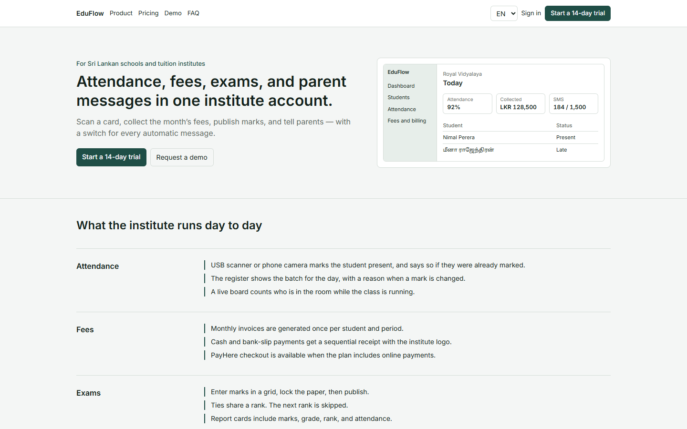
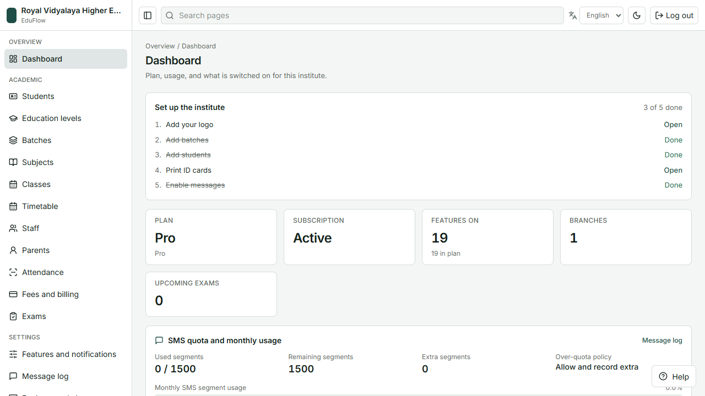
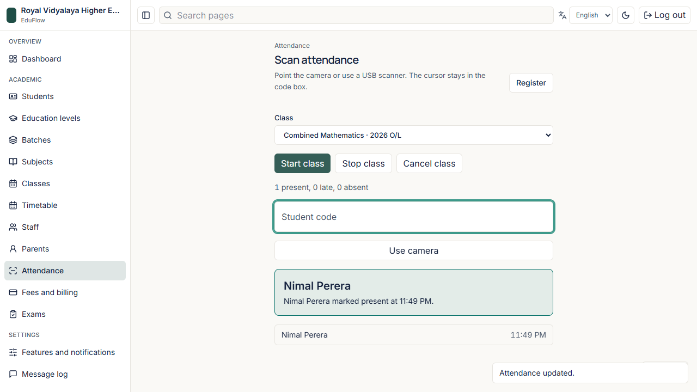
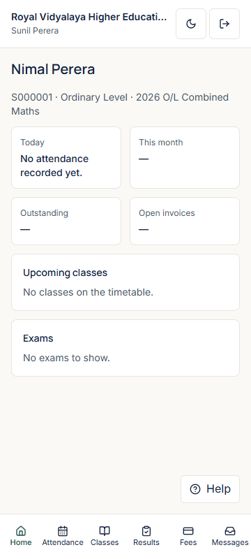

# Admino

Multi-tenant student management SaaS for Sri Lankan schools and tuition institutes.

## Prerequisites

- .NET 8 SDK
- Node.js 22
- Docker & Docker Compose (for the full container stack and Testcontainers SQL Server suite)

## Quick Start (Local Development)

```bash
cp .env.example .env
dotnet run --project src/EduFlow.Api
```

In a second terminal:

```bash
cd web
npm ci
npm run dev
```

- Web App: http://localhost:5173
- API Health: http://localhost:8080/health
- Swagger UI (Development): http://localhost:8080/swagger

## Run Full Stack with Docker

```bash
cp .env.example .env
docker compose up --build
```

For production HTTPS + wildcard subdomains (`*.admino.lk`) using Caddy and `docker-compose.prod.yml`, follow [docs/DEPLOYMENT.md](docs/DEPLOYMENT.md).

## Seed & Demo Credentials

`DbSeeder` automatically creates plans (`Starter`, `Growth`, `Pro`, `Enterprise`), the Super Admin account, and a `demo` institute (*Royal Vidyalaya Higher Education Institute*) with 6 months of Sri Lankan sample students, attendance sessions, fee invoices (including PayHere sandbox), exams, and notifications:

| Role | Institute Subdomain | Login | Password (Dev Default) |
|---|---|---|---|
| **Super Admin** | *(leave blank)* | `superadmin@admino.lk` | `SuperAdmin@123!` |
| **Demo Institute Admin** | `demo` | `admin@demo.admino.lk` | `DemoAdmin@123!` |
| **Demo Teacher** | `demo` | `teacher@demo.admino.lk` | `DemoTeacher@123!` |

Override Super Admin credentials with `SUPERADMIN_EMAIL` / `SUPERADMIN_PASSWORD` in `.env` before production startup. You can also launch the read-only public demo from the landing page (`/`).

## Screenshots

### Public Landing & Pricing


### Institute Admin Dashboard


### Barcode Attendance Scanner


### Mobile-First Parent Portal (360px)


## Tests & Quality Gates

```bash
# Backend unit + integration tests (70%+ Application coverage gate)
dotnet test EduFlow.sln --configuration Release

# Frontend lint, typecheck, unit/component tests (60%+ coverage gate)
cd web && npm run lint && npm run typecheck && npx vitest run --coverage

# Playwright E2E suite (7 end-to-end journeys)
cd e2e && npm ci && npm test
```

See [docs/TESTING.md](docs/TESTING.md) and [docs/ARCHITECTURE.md](docs/ARCHITECTURE.md) for details.

## Production Launch Checklist

- [ ] Copy `.env.example` to `.env` and replace `MSSQL_SA_PASSWORD`, `Jwt__SigningKey` (32+ chars), and `SUPERADMIN_PASSWORD`.
- [ ] Point DNS `@` and `*` (`*.admino.lk`) to the server IP and verify TLS in [docker/Caddyfile](docker/Caddyfile).
- [ ] Set real notification provider credentials (`NotifyLk`, `Smtp`/`Brevo`, `CloudApi`) and verify SMS quota/quiet-hours settings.
- [ ] Configure PayHere live merchant ID + secret per institute (encrypted at rest via ASP.NET Data Protection keys persisted in volume `admino_keys`).
- [ ] Enable `Hangfire__EnableRecurringJobs=true` and `Hangfire__Storage=SqlServer`.
- [ ] Confirm nightly `platform-db-backup` schedule and test a dry-run restore per [docs/DEPLOYMENT.md](docs/DEPLOYMENT.md).
- [ ] Run backend tests, frontend coverage gate, Playwright E2E, and `tests/load/scan-k6.js` (`p95 < 300 ms`).
